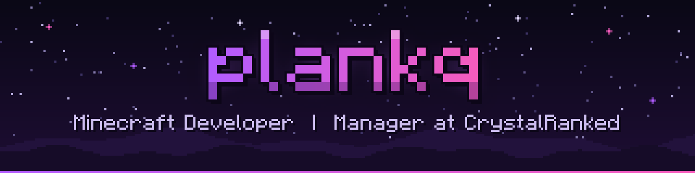

  

i run **[vanillaroyale](https://discord.gg/vanillaroyale)** and build most of what's on it — the plugins, the minigames, the resource packs, the shaders that draw the hud, the panel we run the servers from, and the discord bot.

before that: owner @ mcroyale · admin @ aurora client · general manager @ crystalranked · media @ vanillachaos

 

**what i work with**

 

[discord](https://discord.gg/vanillaroyale) · [builtbybit](https://builtbybit.com/members/YOUR-BBB-ID)
